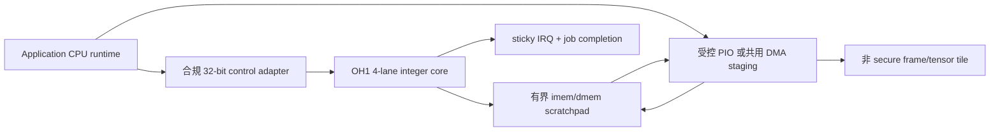

# OH1 media pre/post 小型輔助評估

日期：2026-10-26，Asia/Taipei。狀態：design，非首代量產依賴。

## 來源與定位

基線 main：`8905c6d635372bab22be76524f4a58e28e9c850d`。
已讀改善計畫、README、oh1_pkg、oh1_axi_lite 與 LLVM backend 計畫。
tree 未找到 AGENTS/CLAUDE/CONTRIBUTING；查無 open PR。
跨 repo 合約由 orca-v63 的 edge_soc_integration.md PR 審查。

OH1 是 4-lane SIMT micro-core，僅評估小型 pre/post。
不作 TV UI graphics GPU、不宣稱 OpenGL/Vulkan、FP16 vdot、
多 warp 或完整 C compiler 已驗收。application CPU、ICP/AON 各有獨立責任。

|項目|design|RTL|verified|physical|
|---|---|---|---|---|
|整數 SIMT core|既有 ISA|有|README 有歷史結果，本輪未跑|未證實|
|AXI-Lite wrapper|有 CSR/window|有，見以下問題|本輪未跑|未做|
|media tile staging/DMA/隔離|本輪設計|未實作|未跑|未做|
|FP16/多warp/compiler|既有 roadmap|本輪未證實完整路徑|未跑|未做|

## 原始碼檢查：不得直接當可整合 AXI 周邊

oh1_axi_lite.sv 的 IDLE 只在 AW/W 同拍才保存寫入；
AWREADY 與 WREADY 可各自為1，但分開握手未被保存，
WR_DATA 沒有從 IDLE 進入的路徑。
同一 case 有重複 RD_DATA；WSTRB 未約束實際寫入；
PROG_LEN、DATA_BASE 不等於 memory bounds enforcement。
STATUS busy 以 !done&&!illegal 推得，reset/idle 定義需重新凍結。
這是 source inspection，不能把既有 AXI 4/4 報告當反證或本輪 PASS。
先修 wrapper 與獨立 bus scoreboard，再討論接 SoC。
不在本輪任意修改核心或 ISA。

## 方塊與控制／資料分工

現有 wrapper 是 slave window，不是 burst DMA master。
首 prototype 由 CPU PIO 載入手工 encoded kernel 與 tile；
實驗版才評估共用 media DMA adapter，不為 OH1另造首代必備 DMA。
CSR 和 data window 分開，不能把 AXI-Lite PIO bandwidth 當 AXI4 DDR bandwidth。

pkg 的 MEM_WORDS=4096 是 16KiB word-addressed memory 規格；
實際 core/memory mapping、每 lane 是否共用/別名須由 integration TB 確認，
不能將4 lanes直接乘成64KiB。program/data 都先檢查可用容量。
tile metadata 含 format/stride/ROI/frameID/domain，地址與長度不得 wrap。
核心載入期間停止執行，執行中不允許 CPU 改程式或覆寫 live tile。

## workload 與 ISA／工具鏈限制

|workload|第一版限制|比較對象／結果|
|---|---|---|
|channel reorder、clamp、ROI copy|RGB888 或 INT8、固定範圍|CPU scalar、SIMT、2D DMA，未跑|
|normalize|只 shift/add 與整數 clamp 可表示形式|CPU/NPU preprocessor，未跑|
|色彩轉換|先 CPU/fixed-function；需 multiply 的矩陣另決策|無成本優勢證據|
|resize|先 nearest；bilinear 的乘法/邊界另估|2D scaler/CPU，未跑|
|argmax/metadata|固定最大候選數、integer compare/reduce|CPU/NPU post，未跑|
|NMS|先 CPU；分歧與O(n²)存取風險|不列 OH1 必備功能|

目前 RV32I-like subset 以 add/shift/logic/load/store/SIMT control 為核心；
不能假設一般 MUL/DIV、浮點或 byte load/store 已支援。
RGB byte packing 需 word-load/shift/mask，額外 cycles 必須記入。
以 package encoding helpers＋獨立已知向量產 kernel，
比對 golden ISA 與 RTL；LLVM backend 文件只是計畫，
不阻塞首 prototype，也不冒稱可直接編譯任意 C。

分歧使用 split/join/TMC，尾端不足4 pixels 用 mask，
分歧 stack 上限8層；拒絕超限程式、非法 kernel。
uniform branch 不等於每 lane 任意獨立 PC；不能直接套用通用 GPU kernel。

## 頻寬與成本模型

對 W×H RGB888 一次讀寫的理想 payload = 6WH B。
224×224 tile = 301056 B；30fps = 9.03168 MB/s，
尚未含 PIO bus overhead、packing、kernel load、cache maintenance。
若輸出四 byte 而輸入三 byte，必須改成7WH，不能沿用6WH。
以16KiB scratchpad 容量規格，32×32 RGB888 input+output = 6144B；
若每 pixel 展成32-bit單 channel／三 channel等，重算實際 layout。
這只是容量算術，不能據此宣稱該 tile 已跑通或 SRAM ports 可達頻寬。

理想 4-lane single issue 的上界每 cycle 四個 active-lane integer 指令；
不是4 MAC/cycle，也不能換算 FP16 TOPS。
cycles_total = PIO/DMA-in + launch + kernel + drain/IRQ + copy-out；
報有效 active lanes、divergence、load/store、padding、bytes、CPU 使用量。
CPU/SIMT/fixed-function 必須同輸入、格式、算法、精度、cache狀態、
相同 clock 定義，同時報絕對時間與 cycles；不同頻率不可直接比 cycles。

## CSR／IRQ／隔離、abort 與 power

既有 0x00 CTRL、0x04 STATUS、0x08 PROG_BASE、
0x0c DATA_BASE、0x10 PROG_LEN、0x14 IRQ_ACK 只作原型參考。
新增 VERSION/CAP、sticky done/error、獨立 AW/W buffer、
WSTRB、invalid address/unaligned error、busy-start rejection，
需新 ABI major 或 adapter，不單方面覆寫既有軟體定義。
imem/dmem 0x1*/0x2* window 不可直接開給一般 userspace。
driver 只能載入允許 kernel 與有界 tiles，domain 由可信 driver 設定。

首版單 job、無硬體搶占；abort 停新 copy、等正在接收的 bus 完成、
中止核心、丟棄 partial output、清 scratchpad、回 EABORT。
若無可用 halt/abort RTL，採隔離後 reset 原型，
且明確等待 reset ACK，不能宣稱平滑取消。
illegal/stack/bounds/timeout 為獨立錯誤。
secure frames 禁止送 OH1；不能處理隱私策略後再繞開遮罩。

首 prototype 使用單 clock；跨 CPU 域以合規 adapter/async FIFO。
reset assert async/release sync，IRQ sticky/W1C 且同拍新事件不能遺失。
idle/drain ACK 前不得 gating；power off 後重載 kernel，
不信任 retention 中先前 tenant 的資料。

## 驗證與 go/no-go

|層|必要案例|本輪|
|---|---|---|
|既有 regression|make smoke、simd、rand SEED=7 N_PROG=50|未跑|
|wrapper|AW-first/W-first、B/R stall、WSTRB、同拍讀寫|未跑|
|tile bounds|0/1/3/4/5 pixels、odd stride、unaligned、越界|未跑|
|kernel|同 golden、active mask/divergence/stack、illegal|未跑|
|recovery|busy start、timeout、abort、reset、IRQ/W1C競爭|未跑|
|system|copy+kernel全時間、QoS競爭、buffer ownership|未跑|
|physical|同 workload synth/STA/resource/power估算|未做|

維持既有 SIMT golden/CRV/SVA；scoreboard 不直接複用 RTL結果。
擴充 stalled VALID、window bounds、ownership、abort outstanding 的 SVA；
raw coverage、seed、waiver、mutation結果隨報告保存。
新 bus 測試必須能抓出上述 split AW/W 問題，避免 vacuous pass。

採用條件：相同精度且 kernel+搬移端到端 latency 或 CPU釋放量有可量測優勢，
QoS 無 deadline違反，新增面積/功耗與軟體成本被 SKU owner 接受。
比較門檻在測試前凍結；沒有優勢就保留研究線，
U-CAM/U-OTT/U-TV均可不含OH1，不阻塞首代。
